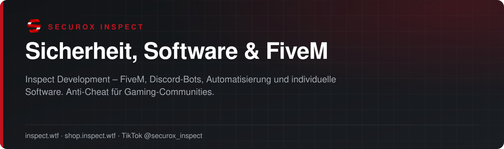

<!-- inspect-showcase: automatisch erzeugt, Änderungen bitte im Shop vornehmen -->

  
  
  
  
  

**SecuroX Inspect** entwickelt Sicherheits- und Anti-Cheat-Lösungen für Gaming-Communities sowie FiveM-Scripts, Discord-Bots, APIs, Automatisierungen und Websites – konzipiert, entwickelt und betreut in Deutschland.

Auf dieser Seite findest du die offiziellen Präsentationen aller Produkte. Gekauft und lizenziert wird ausschließlich im **[INSPECT Shop](https://shop.inspect.wtf)**.

> 🇬🇧 **English:** SecuroX Inspect (Germany) builds anticheat and server protection for gaming communities, FiveM scripts, Discord bots, APIs and automation. All products are sold exclusively at [shop.inspect.wtf](https://shop.inspect.wtf).

<table>
  <tr>
    <td width="25%" valign="top" align="center"><b>🇩🇪 Made in Germany</b> Entwicklung &amp; Support aus einer Hand</td>
    <td width="25%" valign="top" align="center"><b>🛡️ Sicherheit</b> Anti-Cheat &amp; Serverschutz für Communities</td>
    <td width="25%" valign="top" align="center"><b>⚡ Sofort startklar</b> Download &amp; Lizenz direkt nach Zahlung</td>
    <td width="25%" valign="top" align="center"><b>💬 Support auf Deutsch</b> Persönlich im INSPECT Discord</td>
  </tr>
</table>

## Highlights

<table>
  <tr>
    <td width="50%" valign="top"> <b><a href="https://github.com/securox-inspect/fahrzeug-studio">Fahrzeug-Studio</a></b> Alle Funktionen des INSPECT Fahrzeug-Studios ohne Einschränkung – für beliebig viele Fahrzeuge, Props und Ressourcen.  <b>ab 4,99 €</b> &nbsp;·&nbsp; <a href="https://shop.inspect.wtf/fahrzeug-studio">Im Shop ansehen →</a></td>
    <td width="50%" valign="top"> <b><a href="https://github.com/securox-inspect/individuelle-botsysteme">Individuelle Botsysteme &amp; Automatisierung</a></b> Individuelle Bots, Automatisierungen und maßgeschneiderte Systemlösungen für Unternehmen, Teams und …  <b>ab 299,99 €</b> &nbsp;·&nbsp; <a href="https://shop.inspect.wtf/produkt/individuelle-botsysteme">Im Shop ansehen →</a></td>
  </tr>
  <tr>
    <td width="50%" valign="top"> <b><a href="https://github.com/securox-inspect/individuelle-discord-bot-erstellung">Individuelle Discord Bot Erstellung</a></b> Individuelle Discord-Bots nach Kundenwunsch – von einfachen Automationen bis zu komplexen Verwaltungssystemen.  <b>ab 149,99 €</b> &nbsp;·&nbsp; <a href="https://shop.inspect.wtf/produkt/individuelle-discord-bot-erstellung">Im Shop ansehen →</a></td>
    <td width="50%" valign="top"> <b><a href="https://github.com/securox-inspect/inspect-api">INSPECT API Zugang</a></b> Direkter API-Zugang zur INSPECT-Datenbasis für FiveM, Discord-Bots und eigene Anwendungen.  <b>ab 9,95 €</b> &nbsp;·&nbsp; <a href="https://shop.inspect.wtf/produkt/inspect-api">Im Shop ansehen →</a></td>
  </tr>
  <tr>
    <td width="50%" valign="top"> <b><a href="https://github.com/securox-inspect/inspect-discord-bot-community-management">INSPECT Discord Bot – Community Management Edition Open Source</a></b> Professioneller Discord-All-in-One-Bot mit 11 Ticketkategorien, Voice-Support, Whitelist, Moderation, Logs, Umfragen …  <b>ab 299,99 €</b> &nbsp;·&nbsp; <a href="https://shop.inspect.wtf/produkt/inspect-discord-bot-community-management">Im Shop ansehen →</a></td>
    <td width="50%" valign="top"> <b><a href="https://github.com/securox-inspect/inspect-entityguard">INSPECT EntityGuard</a></b> Professionelles Schutzsystem für FiveM-Server gegen unerlaubte Entity-Spawns, Noclip, Freecam und weitere …  <b>69,99 €</b> &nbsp;·&nbsp; <a href="https://shop.inspect.wtf/produkt/inspect-entityguard">Im Shop ansehen →</a></td>
  </tr>
</table>

## Alle Produkte

### FiveM Scripts

| Produkt | Beschreibung | Preis |
|:--|:--|--:|
| **[AFK-Kick System](https://github.com/securox-inspect/afk-kick-system)** | Automatische AFK-Erkennung mit Warnsystem, AFK-Zone samt Rücktransport-NPC und filmreifer Admin-Kick-Szene … | [14,99 €](https://shop.inspect.wtf/produkt/afk-kick-system) |
| **[Inspect Abschlepp Service für FiveM](https://github.com/securox-inspect/inspect-abschlepp-service)** | Komplettes Abschlepp- und Dispatch-System mit Flatbed, Abschleppseil, Skylift, Auftragsverwaltung sowie … | [19,99 €](https://shop.inspect.wtf/produkt/inspect-abschlepp-service) |
| **[Inspect Blackout](https://github.com/securox-inspect/inspect-blackout)** | Realistischer, serverweiter Stromausfall mit Haupt-, Zusatz- und baubaren mobilen Generatoren … | [49,99 €](https://shop.inspect.wtf/produkt/inspect-blackout) |
| **[INSPECT Bürgerbüro – Ausweis, Führerschein, Waffenschein & Hochzeit für FiveM](https://github.com/securox-inspect/inspect-buergerbuero)** | Ein komplettes Amt für euren Roleplay-Server: Personalausweis, Führerschein mit Klassen … | [9,99 €](https://shop.inspect.wtf/produkt/inspect-buergerbuero) |
| **[INSPECT CruiseControl – Tempomat, Geschwindigkeitsbegrenzung & Autopilot für FiveM](https://github.com/securox-inspect/inspect-cruisecontrol)** | Tempomat, Geschwindigkeitsbegrenzung pro Fahrzeugklasse und Fahrzeugmodell sowie ein Autopilot … | [19,99 €](https://shop.inspect.wtf/produkt/inspect-cruisecontrol) |
| **[INSPECT Fahrzeugbilder für FiveM](https://github.com/securox-inspect/inspect-vehicle-images)** | Erzeugt automatisch freigestellte PNG-Bilder aller Fahrzeuge auf deinem Server – inklusive … | [14,95 €](https://shop.inspect.wtf/produkt/inspect-vehicle-images) |
| **[INSPECT Fahrzeugkatalog – Alle GTA- & Add-on-Fahrzeuge finden, testen und prüfen](https://github.com/securox-inspect/inspect-fahrzeugkatalog)** | Das Adminwerkzeug für jeden Server mit Add-on-Fahrzeugen: Alle registrierten Modelle in einem Board … | [12,99 €](https://shop.inspect.wtf/produkt/inspect-fahrzeugkatalog) |
| **[INSPECT Fishing – Das komplette Angelsystem für FiveM](https://github.com/securox-inspect/inspect-fishing)** | Angelplätze an Ufer und Hochsee, Spannungs-Drill, AFK-Angeln, Fischhändler, Zubehörhändler, Bootsverleih … | [39,99 €](https://shop.inspect.wtf/produkt/inspect-fishing) |
| **[INSPECT Fivem Posters Skript](https://github.com/securox-inspect/inspect-posters)** | Performantes FiveM-Postersystem mit freier Platzierung, persistenter Speicherung und … | [19,95 €](https://shop.inspect.wtf/produkt/inspect-posters) |
| **[INSPECT Garages – Garagen, Verwahrhof, Fahrzeugschlüssel und Persistent-Parking in einem System](https://github.com/securox-inspect/inspect-garages)** | Das komplette Fahrzeugsystem für deinen Server: Garagen mit Fahrzeugzustand, Verwahrhof mit … | [39,99 €](https://shop.inspect.wtf/produkt/inspect-garages) |
| **[Inspect Media Player Script Für FiveM](https://github.com/securox-inspect/inspect-mediaplayer)** | Synchronisiertes Media- und Cinema-System für FiveM mit frei platzierbaren Screens, Kino-Modus … | [34,99 €](https://shop.inspect.wtf/produkt/inspect-mediaplayer) |
| **[Inspect Pedmenü Skript Für FiveM](https://github.com/securox-inspect/zday-pedmenu)** | Immansives Ped-ystem mit persönlicher Schnellreise, sicherem Spawn-Schutz und … | [34,99 €](https://shop.inspect.wtf/produkt/zday-pedmenu) |
| **[Inspect SOS-Funk Mechaniker für FiveM](https://github.com/securox-inspect/inspect-sos-funk-mechaniker)** | Frameworkübergreifende KI-Pannenhilfe mit automatischer Framework- und Inventar-Erkennung … | [14,99 €](https://shop.inspect.wtf/produkt/inspect-sos-funk-mechaniker) |
| **[INSPECT Survival Journal für FiveM](https://github.com/securox-inspect/inspect-survival-journal)** | Handgeschriebenes Survival-Tagebuch als Item mit Lore und Tipps für neue Spieler, eigenen Notizen … | [19,99 €](https://shop.inspect.wtf/produkt/inspect-survival-journal) |
| **[INSPECT Weapon Tints – Waffenfarben](https://github.com/securox-inspect/inspect-weapon-tints)** | Waffenfarben, MK2-Camos und Luxury-Finishes als echte Items – dauerhaft pro Waffen-Seriennummer … | [9,99 €](https://shop.inspect.wtf/produkt/inspect-weapon-tints) |

### Botsysteme

| Produkt | Beschreibung | Preis |
|:--|:--|--:|
| **[Individuelle Botsysteme & Automatisierung](https://github.com/securox-inspect/individuelle-botsysteme)** | Individuelle Bots, Automatisierungen und maßgeschneiderte Systemlösungen für Unternehmen, Teams und … | [ab 299,99 €](https://shop.inspect.wtf/produkt/individuelle-botsysteme) |
| **[Individuelle Discord Bot Erstellung](https://github.com/securox-inspect/individuelle-discord-bot-erstellung)** | Individuelle Discord-Bots nach Kundenwunsch – von einfachen Automationen bis zu komplexen Verwaltungssystemen. | [ab 149,99 €](https://shop.inspect.wtf/produkt/individuelle-discord-bot-erstellung) |
| **[INSPECT DB Auto Backup – Linux Edition](https://github.com/securox-inspect/inspect-db-auto-backup-linux)** | Automatische MySQL-/MariaDB-Sicherungen als direkte SQL-Dateien für Linux – mit … | [19,95 €](https://shop.inspect.wtf/produkt/inspect-db-auto-backup-linux) |
| **[INSPECT DB Auto Backup – Windows Edition](https://github.com/securox-inspect/inspect-db-auto-backup-windows)** | Automatische MySQL-/MariaDB-Sicherungen als direkte SQL-Dateien für Windows – mit … | [19,95 €](https://shop.inspect.wtf/produkt/inspect-db-auto-backup-windows) |
| **[INSPECT Discord Bot – Community Management Edition Open Source](https://github.com/securox-inspect/inspect-discord-bot-community-management)** | Professioneller Discord-All-in-One-Bot mit 11 Ticketkategorien, Voice-Support, Whitelist, Moderation … | [ab 299,99 €](https://shop.inspect.wtf/produkt/inspect-discord-bot-community-management) |

### API

| Produkt | Beschreibung | Preis |
|:--|:--|--:|
| **[INSPECT API Zugang](https://github.com/securox-inspect/inspect-api)** | Direkter API-Zugang zur INSPECT-Datenbasis für FiveM, Discord-Bots und eigene Anwendungen. | [ab 9,95 €](https://shop.inspect.wtf/produkt/inspect-api) |
| **[INSPECT-IT App](https://github.com/securox-inspect/inspect-it-app)** | Nutze INSPECT direkt über Discord Apps und prüfe Nutzer per Rechtsklick – schnell, sicher und … | [ab 14,99 €](https://shop.inspect.wtf/produkt/inspect-it-app) |
| **[Partner Premium Zugang](https://github.com/securox-inspect/partner-premium-access)** | Exklusiver 12-Monats-Premium-Zugang für zuvor durch INSPECT genehmigte Partner. | [ab 49,95 €](https://shop.inspect.wtf/produkt/partner-premium-access) |
| **[Single Premium Access](https://github.com/securox-inspect/single-premium-access)** | Premium-Zugang für einzelne Nutzer inklusive Inspect-It App und automatischer Discord-Freischaltung für … | [ab 14,95 €](https://shop.inspect.wtf/produkt/single-premium-access) |

### Anticheat

| Produkt | Beschreibung | Preis |
|:--|:--|--:|
| **[INSPECT EntityGuard](https://github.com/securox-inspect/inspect-entityguard)** | Professionelles Schutzsystem für FiveM-Server gegen unerlaubte Entity-Spawns, Noclip, Freecam und … | [69,99 €](https://shop.inspect.wtf/produkt/inspect-entityguard) |
| **[INSPECT FiveM Security & Discord Integration](https://github.com/securox-inspect/inspect-fivem-security-discord-integration)** | Modulares FiveM-Sicherheitssystem mit Ingame-Adminboard, Prüf-Sperren, Erkennungen und … | [199,99 €](https://shop.inspect.wtf/produkt/inspect-fivem-security-discord-integration) |

### Software

| Produkt | Beschreibung | Preis |
|:--|:--|--:|
| **[INSPECT Privathaushalt](https://github.com/securox-inspect/inspect-privathaushalt)** | Die moderne Finanzverwaltung für private Haushalte – Einnahmen, Ausgaben, Verkäufe, Belege und … | [ab 4,99 €](https://shop.inspect.wtf/produkt/inspect-privathaushalt) |
| **[INSPECT Wirtschaftssystem](https://github.com/securox-inspect/inspect-wirtschaftssystem)** | Die zentrale Unternehmenssoftware für Buchhaltung, Rechnungen, Kunden, Mahnungen und … | [ab 9,99 €](https://shop.inspect.wtf/produkt/inspect-wirtschaftssystem) |

### Webseiten

| Produkt | Beschreibung | Preis |
|:--|:--|--:|
| **[Professioneller Webseitenbau](https://github.com/securox-inspect/professioneller-webseitenbau)** | Moderne Webseiten und Onlineshops für Unternehmen, Dienstleister und Shopbetreiber – individuell nach Wunsch. | [ab 1.999,99 €](https://shop.inspect.wtf/produkt/professioneller-webseitenbau) |
| **[Webseiten für Vereine & Gameserver](https://github.com/securox-inspect/vereine-gameserver-webseite)** | Moderner Internetauftritt für Vereine, Communities und Gameserver – individuell, responsive … | [ab 499,99 €](https://shop.inspect.wtf/produkt/vereine-gameserver-webseite) |

### Fahrzeug-Studio

| Produkt | Beschreibung | Preis |
|:--|:--|--:|
| **[Fahrzeug-Studio](https://github.com/securox-inspect/fahrzeug-studio)** | Alle Funktionen des INSPECT Fahrzeug-Studios ohne Einschränkung – für beliebig viele Fahrzeuge, Props … | [ab 4,99 €](https://shop.inspect.wtf/fahrzeug-studio) |

### FiveM Job

| Produkt | Beschreibung | Preis |
|:--|:--|--:|
| **[INSPECT Jobcreator – Jobs, Ränge, Bossmenü, Teleporter und Fesseln komplett im Spiel verwalten](https://github.com/securox-inspect/inspect-jobcreator)** | Die komplette Job- und Fraktionsverwaltung für deinen Server: Jobs, Ränge und Rechte im Adminboard … | [29,99 €](https://shop.inspect.wtf/produkt/inspect-jobcreator) |

### FiveM job

| Produkt | Beschreibung | Preis |
|:--|:--|--:|
| **[INSPECT Police – Komplettes Polizeisystem mit MDT, Leitstelle, Haft, Bußgeldstelle und Kriminaltechnik](https://github.com/securox-inspect/inspect-police)** | Das komplette Polizeisystem für deinen Server: Dienst-Tablet mit Akten und Abfragen, Leitstelle mit … | [99,99 €](https://shop.inspect.wtf/produkt/inspect-police) |

## Individuelle Entwicklung

Du brauchst ein eigenes System, einen Bot oder eine Anbindung an deinen Server? Wir entwickeln passend zu deinem Framework und deinen Abläufen – sprich uns im **[INSPECT Discord](https://discord.gg/inspect)** an oder schreib an **[info@inspect.wtf](mailto:info@inspect.wtf)**.

## Clips & Updates

Neue Produkte, Vorschauen und kurze Anleitungen zeigen wir zuerst auf TikTok: **[@securox_inspect](https://www.tiktok.com/@securox_inspect)**

---

<b>SecuroX Inspect</b> · Offizielle Produktpräsentation · Dieses Repository enthält keinen Quellcode und keine Produktdateien. 
Kauf und Lizenzen ausschließlich über <a href="https://shop.inspect.wtf">shop.inspect.wtf</a> · Inhalte werden automatisch aus dem Shop aktualisiert.

